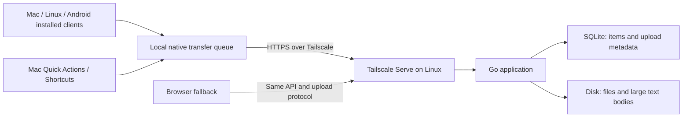

# Household sharing app — architecture proposal

Status: design proposal only; no application implementation or deployment.

Confirmed constraints: initially support files up to 20 GB, keep uploads running when the interface is not open, and make all items visible to the household. The maximum desired text size is not yet specified.

## Product

A private, persistent feed for explicitly shared text and files. Send from one device, then open another device later and use Copy or Download. The Linux server holds the content after an upload completes, so the receiving device does not need to be online when the item is sent.

Start with one household feed. A personal inbox can be added if household members need separate access; a device label alone is not an authorization boundary.

The main screen has a composer, a drop area, upload progress, and recent items. Text cards have Copy, Expand, and Download .txt. File cards have Download, original filename, size, and upload status. Other devices can see a card marked Uploading before the bytes are ready, with Download enabled only after completion. Search, pins, deletion, and configurable expiry keep the feed manageable. A metadata-only live connection updates open clients. Only metadata and requested text/previews sync automatically; 20 GB files do not automatically download to every device.

## Recommended shape

- Frontend: React and TypeScript, shared by Tauri 2 installed clients and a browser/PWA fallback. Bundle the installed frontend locally; authenticate its server API connection rather than loading arbitrary remote pages into a privileged shell.
- Client transfers: a durable native queue separate from the web view, with desktop background/tray operation and an Android native job component. Closing the interface must not destroy a running transfer.
- Server: Go, including the built frontend and an embedded tusd upload handler.
- Database: SQLite for feed metadata, permissions, upload state, and small search fields.
- Content storage: an ordinary directory on the Linux server. Large files and text bodies stay out of feed JSON and database rows.
- Updates: Server-Sent Events (SSE) for item/status changes; clients fetch a bounded feed again after reconnecting.
- Deployment: one application process, optional Docker packaging, a persistent data directory, and Tailscale on the Linux host.

This is a small household service. One server process and a data directory keep deployment and backup simple. Go is a good fit because the reference tus server can be embedded directly. [tusd embedding documentation](https://tus.github.io/tusd/advanced-topics/usage-package/)

## Large files

Treat uploads as durable transfer sessions, separate from feed items. Use the existing tus resumable upload protocol. Send bounded chunks to disk, retain the confirmed offset, and resume from it after a network interruption. Do not hold the complete file in browser or server memory, encode it as base64, or send it over the live event connection. [tus specification](https://tus.io/protocols/resumable-upload)

An upload is only ready to download after its expected size and completion checks pass. Keep the upload record durable across server restarts; publish the ready item and its metadata consistently. Hashing must also be incremental. Strong end-to-end verification requires comparing against a sender-computed digest; a server-generated digest by itself is not proof that the sender's original bytes matched.

Downloads use an authenticated URL, attachment headers, and HTTP byte ranges so capable browsers and download managers can resume. Installed clients download through their durable native queue to a user-selected destination. The browser fallback uses the browser's normal download mechanism rather than fetching a huge Blob into JavaScript first. Range support enables resumable downloads; the browser/download manager determines its resume behavior. [HTTP range requests](https://developer.mozilla.org/en-US/docs/Web/HTTP/Guides/Range_requests)

Resumable protocol support does not mean a browser retains access to a local source file forever. Following a tab/browser restart, the user may have to select the same file again; validate that source before resuming. A native companion can keep a more durable queue and file access.

Avoid promising unlimited size. Configure maximum item size, total storage usage, and minimum free disk space; count unfinished transfers toward that budget. Clean up abandoned uploads and expose storage usage. Complete files should remain until deleted initially, with optional expiry and pinned exceptions added deliberately. Capacity and achievable speed depend on disk, network, client, and transfer implementation.

The server stores a full copy and sends a second transfer to each downloader. It must stay online to accept shares or serve content. Direct device-to-device transfer could be a later optimization, but should not be a prerequisite for retrieving an item later. Tailscale direct connections generally outperform relayed connections, so performance validation should include connection type. [Tailscale connection types](https://tailscale.com/docs/reference/connection-types)

## Large text and copying

Store the full text body separately, return a short preview in the feed, and load the full body only when needed. Keep shared text plain and inert; preserve stored whitespace, Unicode, and line breaks without adding formatting. A card preview may be shortened; Copy must operate on the full stored text.

Preload small recent items so their Copy action can complete quickly. For large unloaded items, show preparation progress and, where browser activation rules require it, a final Copy button after loading. Only show a success message after the clipboard write succeeds. Always provide Download .txt, including for bodies too large for the device's clipboard or destination application.

A browser requires a secure context for programmatic clipboard access, and user activation/permission rules differ between browsers. Therefore explicit Paste and Copy are the supported default; passive clipboard monitoring and guaranteed automatic replacement on other devices are outside the initial design. [Clipboard API](https://developer.mozilla.org/en-US/docs/Web/API/Clipboard_API)

There should be no Discord-style small character cap, but the browser, OS clipboard, memory, and receiving application still have practical limits. Storing a very large text body and copying that entire body are separate capabilities.

## Clients and OS integration

The installed clients should reuse the same frontend through Tauri 2, with native functionality behind a small platform adapter. The browser/PWA remains a useful fallback on Mac, Linux, and Android. A PWA is not the basis for a promise that multi-gigabyte uploads continue while the screen is locked. Browser transfers remain foreground-oriented and resumable. Android Chrome has an installed-PWA share-target capability, but it is not needed for the native design; private-site installation and actual share handling would require separate validation. [Chrome Web Share Target](https://developer.chrome.com/docs/capabilities/web-apis/web-share-target), [Background Fetch limitations](https://developer.mozilla.org/en-US/docs/Web/API/Background_Fetch_API)

For macOS, the first integration should be a Shortcut or Finder Quick Action backed by a resumable upload helper. It can accept files or selected text and offer an explicit Send Clipboard keyboard command. It need not open the main interface. The helper should queue long transfers and expose progress; a shell action that merely starts a large blocking HTTP request is insufficient. Shortcuts can also be exposed through the share sheet where supported; test the actual apps and accepted input types. [Apple: run a shortcut while working](https://support.apple.com/en-gb/guide/shortcuts-mac/-apd163eb9f95/mac)

A native Share extension is a separate integration from a Finder Quick Action or Shortcut. A cross-platform wrapper does not automatically supply that extension. The Tauri desktop client should provide a tray/menu-bar interface, global shortcut, native clipboard, and transfer queue in the initial installed release. Closing its window keeps the background process alive; explicitly quitting or shutting down pauses transfers, which must be resumable. Locally used Mac builds can use ad-hoc signing without an Apple-authenticated identity; downloaded builds can still require a local security approval. [Tauri ad-hoc signing](https://v2.tauri.app/distribute/sign/macos/#ad-hoc-signing)

Because background uploads are required, include native Android transfers in the first release. Implement incoming share intents, durable file access, and OS-managed transfers through a Tauri Kotlin plugin/job service. On Android 14+, schedule a user-initiated data transfer (UIDT) job while the Send/share-receiver activity is visible, before dismissing it, and provide estimated bytes plus a progress notification. UIDT is exempt from ordinary job quotas but remains subject to system constraints. Persist resumable state continuously, including for cases where no stop callback arrives. Android 16 can charge long-running WorkManager foreground workers against job quotas, so explicit 20 GB transfers should use native UIDT. On older supported Android releases, use an appropriate foreground service and handle its version-specific duration limits. Resume after permitted restarts rather than promising that Android can never stop a transfer. An embedded web view alone does not add these features. [Android user-initiated transfers](https://developer.android.com/develop/background-work/background-tasks/uidt), [WorkManager quotas](https://developer.android.com/develop/background-work/background-tasks/persistent/how-to/long-running), [foreground-service limits](https://developer.android.com/develop/background-work/services/fgs/timeout), [Tauri native mobile plugins](https://v2.tauri.app/develop/plugins/develop-mobile/)

Shared Android content may arrive with temporary URI access. Persist permission when the source allows it; otherwise make a durable staged copy and check free space first. A 20 GB share must not unexpectedly require multiple 20 GB copies. Select a file through the storage picker when that gives durable access without staging. Upload queue persistence and source accessibility are separate requirements. [Android document access](https://developer.android.com/training/data-storage/shared/documents-files)

The concrete no-account Android installation fallback is a locally signed APK installed from the user's Mac or Linux computer through Android Debug Bridge (ADB). Enable USB debugging, authorize the computer on the phone, and use `adb install app.apk` for the initial installation or `adb install -r app.apk` for an update signed with the same key. Preserve that signing key for future updates. ADB is an installation/development tool; normal app use does not require leaving the phone connected to the computer. Google's verification FAQ explicitly preserves ADB installs without developer registration or verification, so this route does not depend on the advanced-flow waiting period. [Android verification FAQ](https://developer.android.com/developer-verification/guides/faq), [ADB setup and installation](https://developer.android.com/tools/adb)

Direct tap-to-install APKs are another possible route. The initial September 2026 verification phase excludes direct sideloads according to the current FAQ, but broader rollout is planned for 2027. Where verification applies, Google documents an account-free advanced user flow for unverified apps, with one-time setup and a waiting period. Confirm the actual phone's behavior rather than assuming all installation routes remain unchanged. [Android developer verification](https://developer.android.com/developer-verification), [Google's advanced installation flow](https://android-developers.googleblog.com/2026/03/android-developer-verification.html)

## Tailscale and access

Use Tailscale Serve for HTTPS access restricted to the tailnet. Bind the application to loopback, restrict access to the intended household users/devices, and leave public Funnel exposure disabled. HTTPS also supports clipboard and PWA capabilities. Serve can forward Tailscale user identity, but those identity headers are absent for tagged source devices. Only trust those headers through the local Serve proxy. [Tailscale Serve](https://tailscale.com/docs/features/tailscale-serve)

Use Tailscale identities for household attribution where available. If device pairing is needed, pair once with revocable device credentials. Enforce access on uploads, downloads, events, and deletion; include browser origin/CSRF protection. If personal inboxes are added, base their access on authenticated people, not display names or device labels. Transport is encrypted; the server can read the stored content. Disk encryption is a separate host setting.

## Delivery order and validation

1. Validate the highest-risk paths in a small feasibility spike: ad-hoc Mac installation, Mac capture into a background queue, Android share intake with durable source access, locked-screen transfers, and no-account APK installation on the actual phone.
2. Build the server and common interface with durable text/file storage, resumable upload, direct download, live feed, Copy, and storage management.
3. Complete the Tauri installed clients, desktop queues, Android native transfers, and Mac Shortcut/Quick Action capture. Keep the browser fallback, but do not label a web-only milestone as satisfying the background-upload requirement.

Before calling the first release ready, test a 20 GB file through interrupted upload, server restart, client restart, and interrupted download. Compare the downloaded bytes with the original. Test multi-megabyte Unicode text, full stored text copying, clipboard failure, phone memory pressure, disk exhaustion, and access denial. For native Android, also test screen lock, background operation, process termination, and temporary source URI permissions. The 20 GB target is a requirement to validate, not a currently demonstrated guarantee. Clarify decimal GB versus GiB when implementing the configurable limit.

Open details: Android OS version/model; typical maximum text size; server storage capacity; retention preference. The shared feed, 20 GB file target, and background uploads are settled for this proposal.
